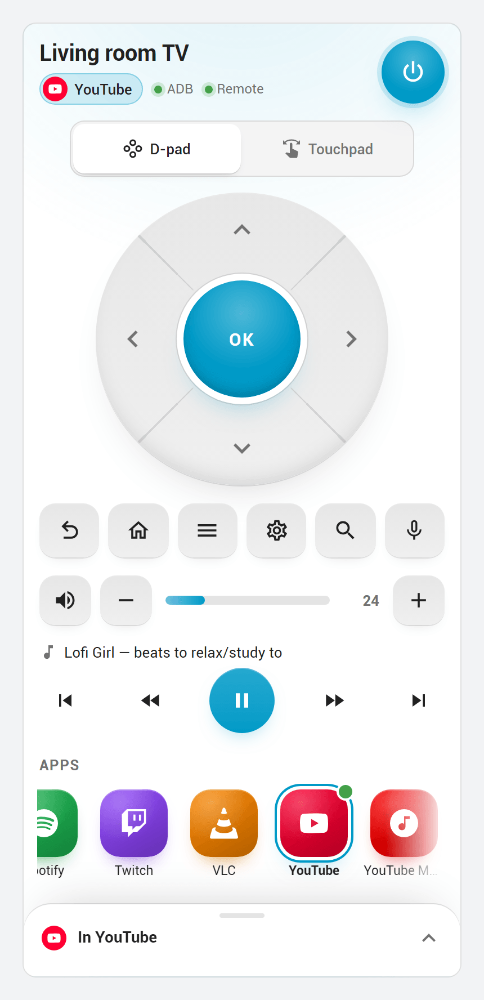
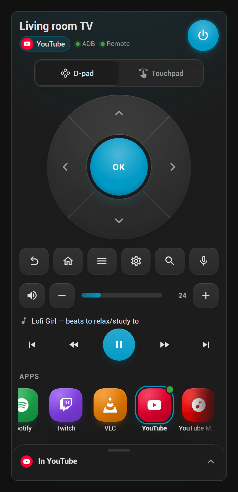

# Android TV Pilot

[](https://github.com/VahaC/ha-android-tv-pilot/actions/workflows/validate.yml)
[](https://github.com/VahaC/ha-android-tv-pilot/actions/workflows/tests.yml)

A Home Assistant custom integration for Android TVs that go into deep standby, such as Xiaomi
Mi TV / Xiaomi TV models. It gives you one device with a `media_player` and a `remote` entity
whose **turn on works from any state**, including deep standby (Wi-Fi off), plus fast control
inside apps: instant key presses, app launching, deep links, typing text and screenshots. A
companion dashboard card ships with it.

The integration is self-sufficient: it does **not** need the core `androidtv` (ADB) or
`androidtv_remote` integrations. It talks to the TV directly over two transports:

- **ADB over the network** (port 5555, library `adb-shell`): state polling, app list, launching
  apps, deep links, text fallback, screenshots, raw shell commands.
- **Android TV Remote protocol v2** (ports 6466/6467, library `androidtvremote2`): instant key
  presses, volume, typing text and push updates (screen on/off, current app, volume).

If the remote protocol is unavailable the integration works with ADB alone (slower keys).

## Screenshots

The remote card that ships with the integration, in the light and the dark theme:

<p align="center">
  
  &nbsp;&nbsp;
  
</p>
<p align="center"><em>Light</em> &nbsp;·&nbsp; <em>Dark</em></p>

## How turn on works

| TV state                                    | What `turn_on` does                                     |
|---------------------------------------------|---------------------------------------------------------|
| Reachable, screen on                        | Nothing                                                 |
| Reachable, screen off                       | Sends `WAKEUP`                                          |
| Unreachable (deep standby), wake entity set | Triggers the wake entity, waits for the TV to come online, triggers it again every *re-press interval* until the *wake timeout*, then sends `WAKEUP` if the screen is still off |
| Unreachable, no wake entity                 | Fails with an explanation                               |

While waking, the media player shows `power_state: waking`; a timeout shows `wake_state: failed`
until the next attempt or until the TV becomes reachable. Several `turn_on` calls at once share
one wake.

## Requirements

- Home Assistant 2025.1 or newer (tested with 2026.10). The integration icon inside the
  integration folder is shown from Home Assistant 2026.3; older versions show no icon.
- **Network debugging (ADB) enabled on the TV**: Settings → Device preferences → About → press
  *Build* 7 times, then Developer options → *USB debugging* (and *Network debugging* / *ADB over
  network* where the TV has it). Give the TV a fixed IP address in your router.
- For TVs with **deep standby**: a wake entity, usually an ESP32 (see
  [Waking the TV from deep standby](#waking-the-tv-from-deep-standby-esp32)).
- Optional: the *Android TV Remote Service* on the TV (preinstalled on most Android TV / Google TV
  devices) for instant keys and live state.

## Installation

### Marketplace (Home Assistant 2026.11 and newer)

Since Home Assistant 2026.11 the community store is built in as the **Marketplace**
(Settings → Marketplace). Until Android TV Pilot is in the Marketplace catalog, add it from its
link:

[](https://my.home-assistant.io/redirect/marketplace_repository/?owner=VahaC&repository=ha-android-tv-pilot&category=integration)

1. Click the button above, or go to **Settings** → **Marketplace**, select **Add from link** in
   the upper-right corner, enter `VahaC/ha-android-tv-pilot` (or the full GitHub URL) under
   **GitHub link** and select **Add**. If you are asked for the type, choose *Integration*.
   Adding a repository by link needs GitHub to be connected to the Marketplace (Settings →
   Devices & services → Marketplace → ⋮ → Reconfigure).
2. On the repository page select **Install**, check the version and select **Install** again.
3. The setup of Android TV Pilot opens on its own when the integration can load right away. If
   Home Assistant needs a restart instead, a repair under **Settings** → **System** →
   **Repairs** asks for it and can restart for you. You can also start the setup at any time:

   [](https://my.home-assistant.io/redirect/config_flow_start/?domain=android_tv_pilot)

   or Settings → Devices & services → *Add integration* → **Android TV Pilot**.

The dashboard card is part of the integration and registers itself; there is nothing to install
for it separately.

> **Home Assistant 2026.10 or older:** use HACS → ⋮ → *Custom repositories*, add
> `https://github.com/VahaC/ha-android-tv-pilot` with the type *Integration*, download
> **Android TV Pilot** and restart Home Assistant
> ([open in HACS](https://my.home-assistant.io/redirect/hacs_repository/?owner=VahaC&repository=ha-android-tv-pilot&category=integration)).

### Manual

1. Download the source code of the latest
   [release](https://github.com/VahaC/ha-android-tv-pilot/releases) (or of the `main` branch).
2. Copy the folder `custom_components/android_tv_pilot` into `<config>/custom_components/`, so
   that `<config>/custom_components/android_tv_pilot/manifest.json` exists. The dashboard card
   is already inside it (`frontend/android-tv-pilot-card.js`).
3. Restart Home Assistant and add the integration as above.

## Waking the TV from deep standby (ESP32)

**Why it is needed.** Xiaomi TVs (and boxes such as the Mi Box S) switch Wi-Fi off in deep
standby, so nothing on the network can reach them: not ADB, not the remote protocol, not
Wake-on-LAN. Only the Bluetooth chip stays awake, and it reacts to one thing: a Bluetooth LE
advertisement from the address of the TV's own paired remote, the one the remote sends when you
press its power button. An ESP32 near the TV can send that advertisement on request.

**What to buy.** Any ESP32 with Bluetooth LE (ESP32, ESP32-C3 or ESP32-S3; a small board such
as an M5Stack Atom Lite is enough), powered over USB and placed within a few metres of the TV.
An ESP8266 has no Bluetooth and does not work.

**How to build it.** Follow the community guide
[Wake a Xiaomi TV / box from deep standby with an ESP32 (Bluetooth, ESPHome)](https://community.home-assistant.io/t/wake-a-xiaomi-tv-box-from-deep-standby-with-an-esp32-bluetooth-esphome/1035816)
and use the ESPHome firmware from
[dckiller51/esphome-xiaomi-ble-wake](https://github.com/dckiller51/esphome-xiaomi-ble-wake),
written by **dckiller51**. That repository also provides a browser-based web installer (linked
from its README), so you can flash the ESP32 without setting up ESPHome yourself. The firmware
needs two addresses:

- the **TV's Bluetooth address**: Settings → Device preferences → About → Status → Bluetooth
  address;
- the **remote's Bluetooth address**: `adb shell getprop persist.bluetooth.wakeuprcaddr` (drop
  the trailing `;`), or Settings → Remotes & accessories.

Once the ESP32 is in Home Assistant (ESPHome integration) it exposes a button entity, for
example `button.xiaomi_ble_wake_wake_the_tv`. Choose it as the **wake
entity** when you set up Android TV Pilot, or later under *Configure*.

**Other wake methods work too.** The wake entity can be any entity of these domains, and the
integration calls the matching action:

| Domain                    | Action                                                    |
|---------------------------|-----------------------------------------------------------|
| `button`, `input_button`  | press                                                     |
| `switch`, `input_boolean` | turn on (if it is already on: off, then on)               |
| `script`                  | run it and wait for it, at most one re-press interval     |
| `scene`                   | turn on                                                   |

So an IR blaster button, a smart plug that power-cycles the TV, or a script that sends
Wake-on-LAN (for TVs that keep their network up) can be used instead of the ESP32.

## Setup walk-through

Turn the TV on (screen lit) before you start.

1. **Connect over ADB**: enter the TV's IP address, a name and the ADB port (5555). After
   *Submit* the TV shows *Allow USB debugging?*: tick *Always allow from this computer* and press
   OK within 30 seconds. If you were too slow, accept the prompt and press *Submit* again.
2. **Pair the remote protocol**: the TV shows a 6-character code; type it in. If no code appears
   (the remote service is missing or blocked), tick *Skip, use ADB only*.
3. **Wake from deep standby**: pick the wake entity (optional, see above), the wake timeout
   (default 40 s) and the re-press interval (default 8 s).

Keys and certificates are generated on first setup and stored in `<config>/.storage/` as
`android_tv_pilot_adbkey`, `android_tv_pilot_adbkey.pub`, `android_tv_pilot_remote_cert.pem` and
`android_tv_pilot_remote_key.pem`. They are never logged. Keep them out of public backups.

### Options

Settings → Devices & services → Android TV Pilot → *Configure*:

- **Wake, volume and polling**: wake entity, wake timeout, re-press interval, an external volume
  entity (for example a soundbar `media_player`: volume up/down/mute/set are sent to it instead of
  the TV), the ADB poll interval (default 5 s) and *Hide system apps* (default on: preinstalled
  packages that are not in the built-in app catalogue are hidden).
- **Customise an app**: per package, a label, an icon URL and visibility (automatic / always
  show / hide).

If the TV forgets the pairing or the ADB authorisation, Home Assistant shows a *re-authenticate*
notification that walks you through the same prompts again.

## Entities

- `media_player.<name>`: states `off` / `idle` / `playing` / `paused` / `on`; source = current
  app; select source launches an app; `play_media` with type `app` (package) or `url` (deep link);
  volume and transport controls. While the TV sleeps the state is `off` (never `unavailable`), so
  *turn on* stays available. Extra attributes for the card are listed in [docs/api.md](docs/api.md).
- `remote.<name>`: `turn_on` / `turn_off`, `send_command` with the key vocabulary
  (`num_repeats`, `delay_secs`, `hold_secs` > 0 for a long press), `activity_list` = apps.

## Services

| Service                         | What it does                                                          |
|---------------------------------|-----------------------------------------------------------------------|
| `android_tv_pilot.send_key`     | `key` + `action` (`press`, `long`, `down`, `up`)                      |
| `android_tv_pilot.send_text`    | Types `text`, optionally presses Enter                                |
| `android_tv_pilot.launch_app`   | Starts `package`                                                      |
| `android_tv_pilot.open_url`     | Opens `url` (optionally in `package`)                                 |
| `android_tv_pilot.adb_command`  | Runs a raw shell `command`, returns `{output}`                        |
| `android_tv_pilot.refresh_apps` | Re-reads the installed apps                                           |

Key vocabulary: `UP DOWN LEFT RIGHT CENTER BACK HOME MENU SETTINGS POWER WAKEUP SLEEP VOLUME_UP
VOLUME_DOWN MUTE PLAY PAUSE PLAY_PAUSE STOP NEXT PREVIOUS REWIND FAST_FORWARD CHANNEL_UP
CHANNEL_DOWN INFO GUIDE SEARCH ASSIST TV INPUT CAPTIONS DELETE ENTER TAB ESCAPE 0-9 RED GREEN
YELLOW BLUE`, plus any `KEYCODE_*` name or numeric key code.

`adb_command` is deliberately raw (no quoting), so it is **admin-only**: non-admin users get
"Unauthorized". All other inputs are validated and quoted.

Examples:

```yaml
action: android_tv_pilot.open_url
target:
  entity_id: media_player.living_room_tv
data:
  url: https://www.youtube.com/watch?v=dQw4w9WgXcQ
  package: com.google.android.youtube.tv
```

```yaml
action: media_player.play_media
target:
  entity_id: media_player.living_room_tv
data:
  media_content_type: app
  media_content_id: org.jellyfin.androidtv
```

The websocket API used by the card is documented in [docs/api.md](docs/api.md).

## Troubleshooting

- **"The TV did not allow the connection in time"** during setup: the *Allow USB debugging?*
  dialog is on the TV. Accept it with *Always allow* ticked and press *Submit* again.
- **The TV keeps asking "Allow USB debugging?"** (for example after *Revoke USB debugging
  authorisations*): the integration stops retrying ADB for a while (1, then 5, then 15 minutes)
  so it does not prompt on every poll, and after two unanswered prompts Home Assistant shows a
  *re-authenticate* notification. Follow it with the TV on and accept the prompt.
- **Remote protocol unreachable**: check that *Android TV Remote Service* is installed and up to
  date (Play Store), or continue with ADB only. You can pair later by removing and re-adding the
  integration.
- **Turn on fails with a timeout**: check that the wake entity works on its own (press it in
  Home Assistant and watch the TV), raise the wake timeout, and make sure the TV gets the same IP
  address after waking.
- **"The wake entity ... does not exist or is unavailable"**: the ESP32 (or other wake device) is
  offline or was renamed; fix it, or pick another entity under *Configure*.
- **Text with non-Latin letters fails**: ADB can only type plain ASCII; pair the remote protocol
  to type other characters.
- **State is slow to update**: without the remote protocol, state comes from ADB polling (every
  5 s by default; change it in the options).
- **Card looks outdated or blank after an update**: restart Home Assistant, then reload the
  browser tab with a hard refresh (Ctrl+Shift+R / Cmd+Shift+R; in the companion app: Settings →
  Companion app → Debugging → Reset frontend cache). The card shows a hint when its version and
  the running integration's version differ.
- Debug logs:

  ```yaml
  logger:
    logs:
      custom_components.android_tv_pilot: debug
      adb_shell: info
      androidtvremote2: debug
  ```

- Diagnostics (device page → *Download diagnostics*) contain the state and app list with the host,
  serial and MAC redacted.

## Card

See [docs/card.md](docs/card.md).

## License

MIT, see [LICENSE](LICENSE).
